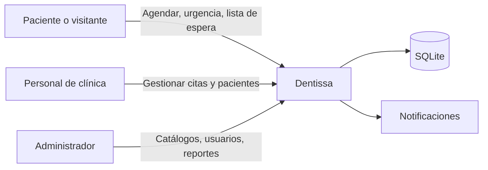
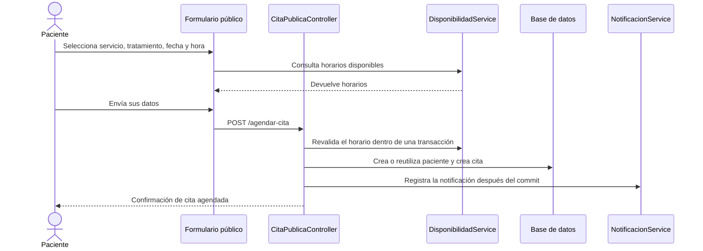
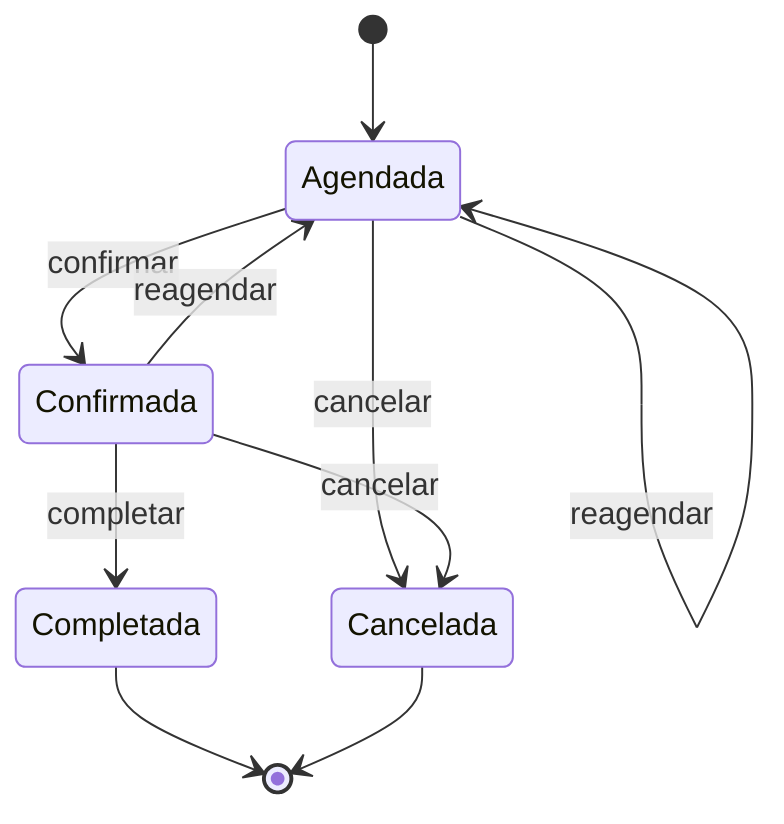
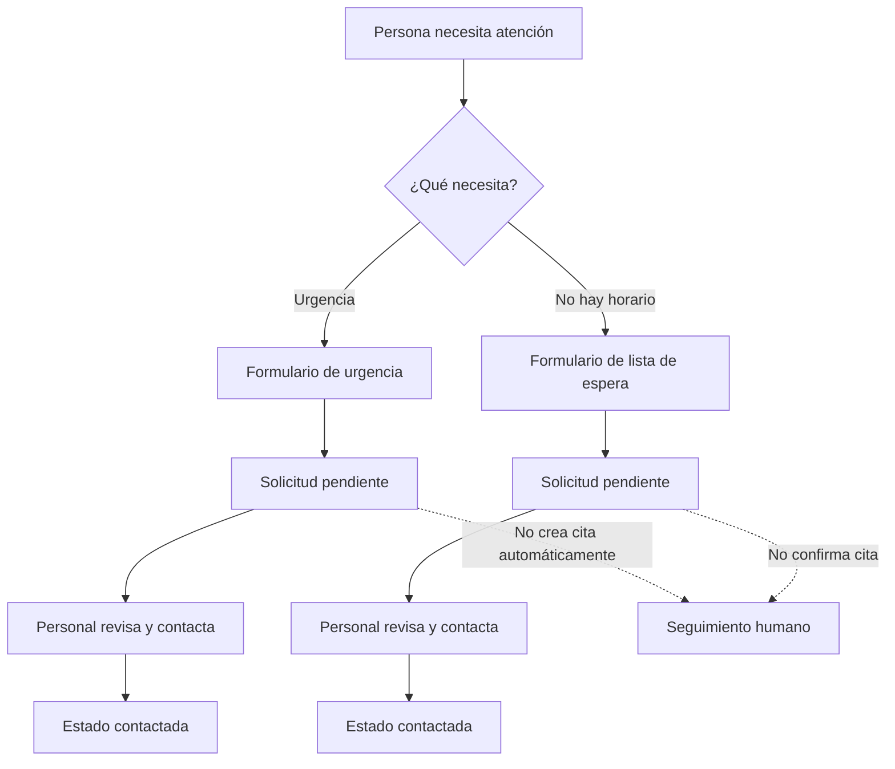
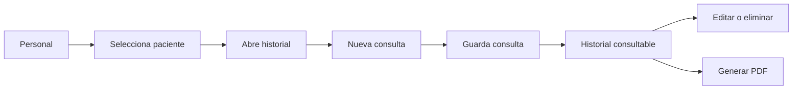

# Diagramas y flujos de Dentissa

Los bloques siguientes usan Mermaid. GitHub puede renderizarlos directamente
en Markdown.

## 1. Actores y canales

## 2. Agendamiento público

## 3. Gestión de estados de una cita

## 4. Atención oportuna

## 5. Historial clínico

## 6. Observaciones para la siguiente etapa

- El asistente de agenda actualmente es un asistente guiado: propone horarios
  y requiere confirmación humana.
- Las listas de atención muestran pendientes; los registros contactados se
  conservan, pero todavía no existe una vista histórica dedicada.
- Las imágenes y assets visuales se incorporarán posteriormente con recursos
  preparados fuera de este flujo de desarrollo.
