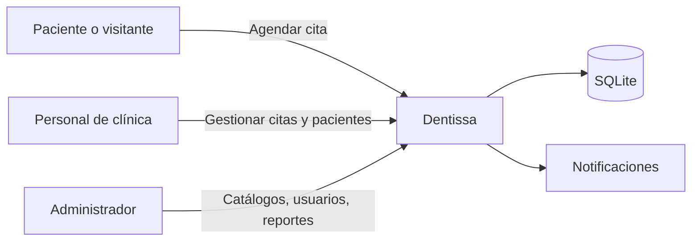
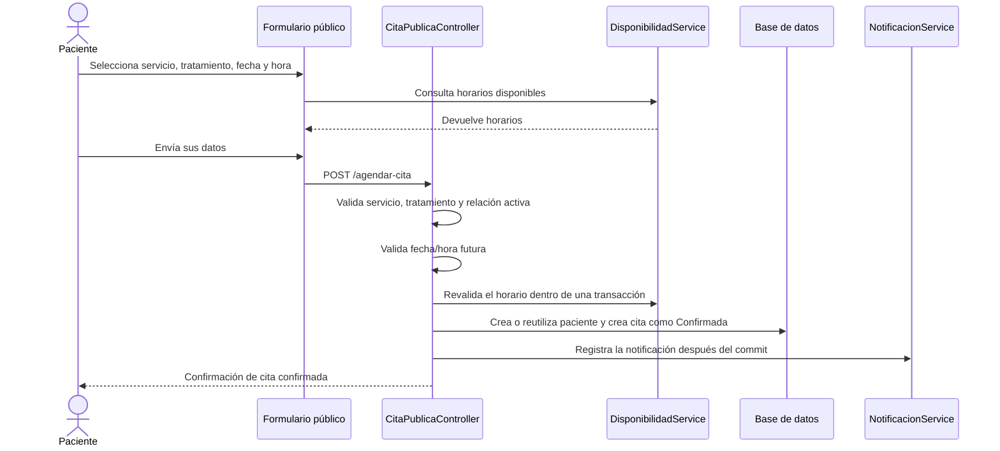
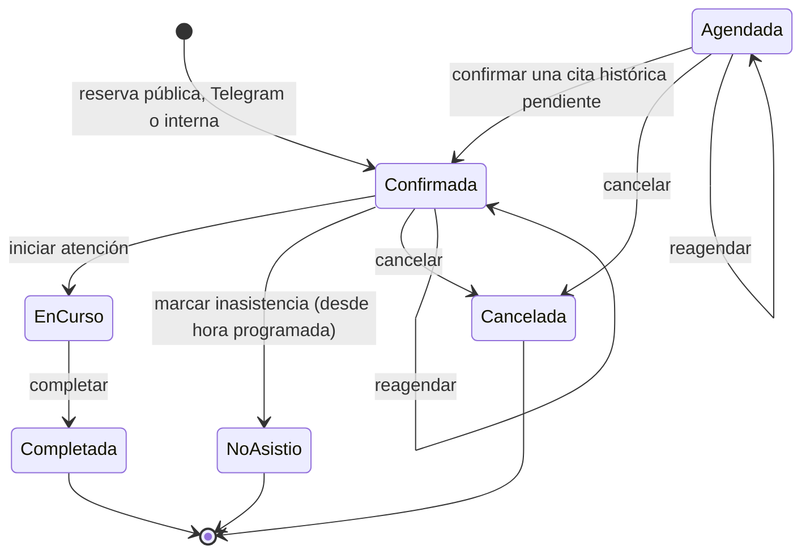
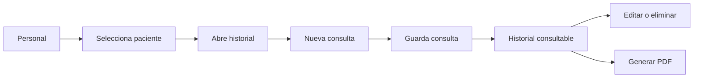

# Diagramas y flujos de Dentissa

Los bloques siguientes usan Mermaid. GitHub puede renderizarlos directamente
en Markdown.

## 1. Actores y canales

## 2. Agendamiento público

Si la combinación de catálogo no está activa, el tratamiento no pertenece al
servicio elegido, la fecha ya pasó o el horario fue ocupado, el formulario
devuelve errores y no crea la cita.

## 3. Gestión de estados de una cita

La aplicación no permite completar directamente una cita **Agendada** o
**Confirmada**: primero debe pasar a **En curso**. Las acciones de iniciar,
marcar inasistencia y completar requieren autorización del personal.
La inasistencia se rechaza si la fecha y hora programadas aún están en el
futuro.

## 4. Historial clínico

## 5. Observaciones para la siguiente etapa

- El asistente de agenda actualmente es un asistente guiado: propone horarios
  y requiere confirmación humana.
- Las listas de atención separan pendientes de historial; el historial puede
  filtrarse por estado y rango de fechas.
- Las imágenes y assets visuales se incorporarán posteriormente con recursos
  preparados fuera de este flujo de desarrollo.
